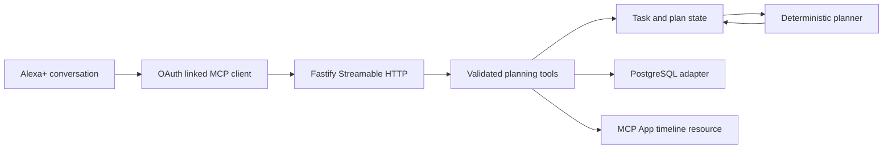

# Architecture

## Shape

Alexa+ client → Fastify `/mcp` → MCP SDK Streamable HTTP transport → validated tool handler → domain state store → deterministic planner. A screen resource is returned using the MCP Apps HTML resource profile. Voice output remains possible from concise structured tool data.

The project uses a stateless transport request lifecycle; customer state lives in PostgreSQL when `DATABASE_URL` is configured. Tool code is synchronous deterministic domain logic except for persistence. State revisions reject stale writes, and bounded request-response caching makes mutating MCP retries idempotent. There are no LLM calls or calendar network calls in normal planning paths.

## Planning decisions

The scheduler removes unavailable intervals from the planning window, orders ready tasks by a stable score combining deadline urgency, priority, flexibility, and effort, and schedules prerequisites before dependent work. It fills available windows with work blocks capped at the task deadline. Unscheduled remainder and blocked dependencies are returned as warnings. Risk is low with no warnings, medium with one, and high with multiple warnings. Replans create a new plan version and append a reason/change trace.

What-if skip uses a structured clone of the customer state and invokes the same planner on that clone. Only the result is returned; the persistent source state is not written.

## State and tenancy

Development mode has one local identity and process-memory storage. Postgres stores one JSON state document per authenticated subject using a parameterized upsert. State is not shared across distinct user subjects in the database. The server deliberately refuses to start in production with development auth. Before production, connect a real account-linking authorization server and durable identity mapping (see [SECURITY.md](SECURITY.md)).

## MCP Apps view

The UI is a compact responsive HTML resource bundled as a single file with `@modelcontextprotocol/ext-apps`. Planning tools advertise `ui://deadline-zero/plan.html` through MCP Apps metadata, and the app renders actual tool results, updates with host context, and can start the next focus session. Alexa host display-mode behavior still needs simulator verification.
